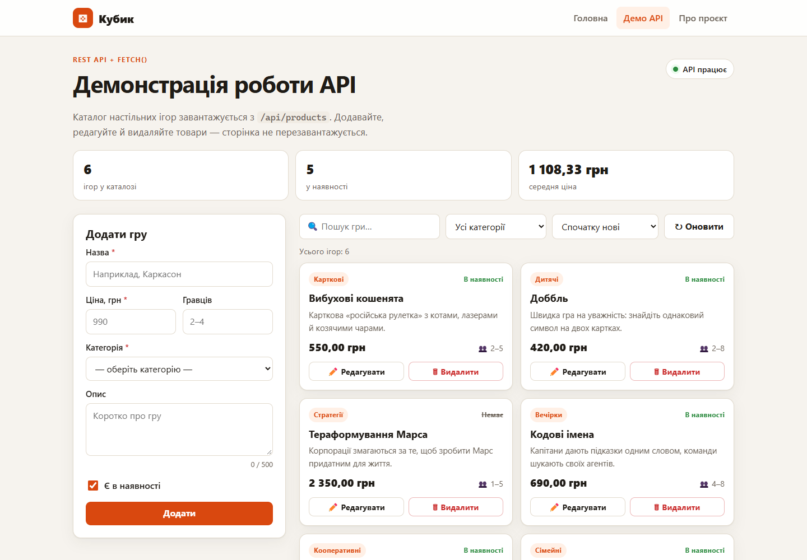
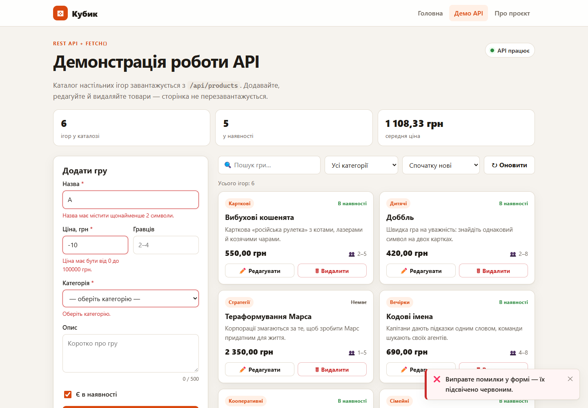
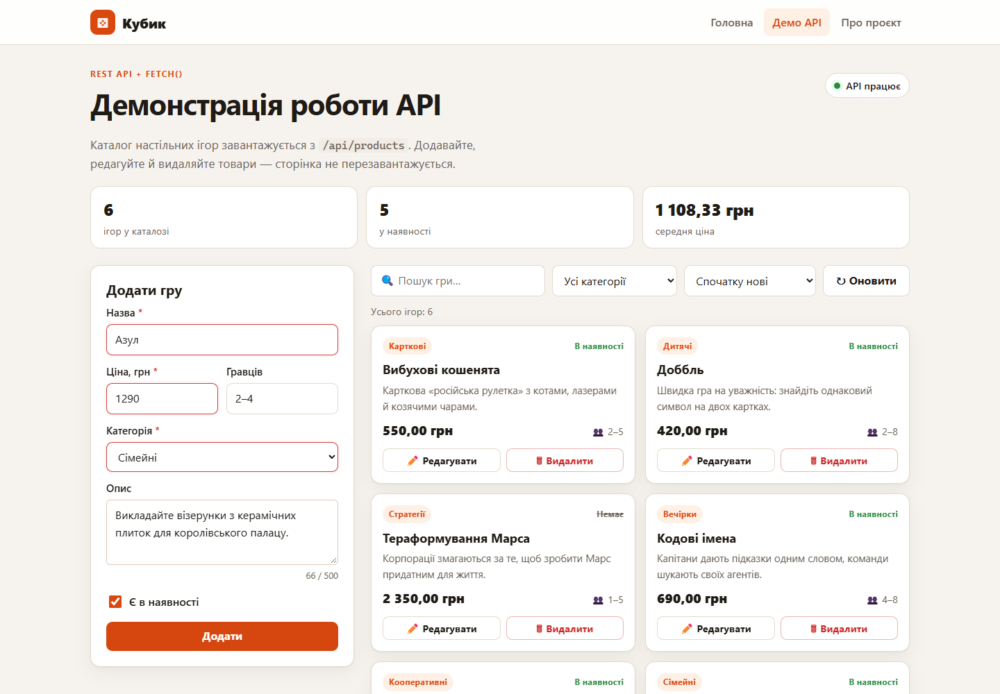
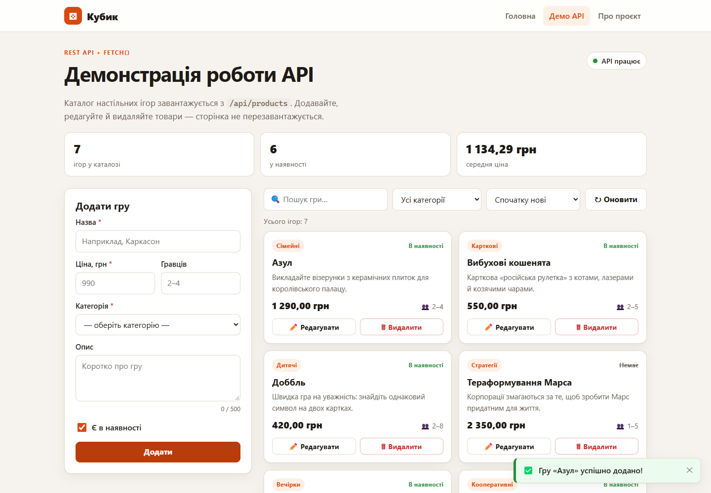
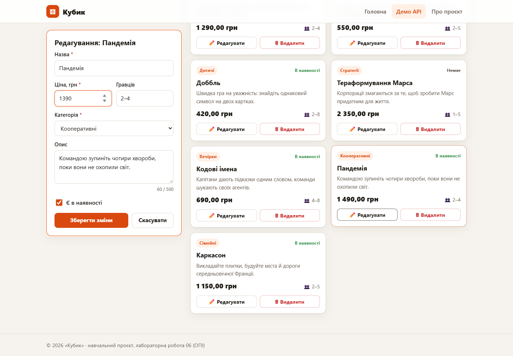
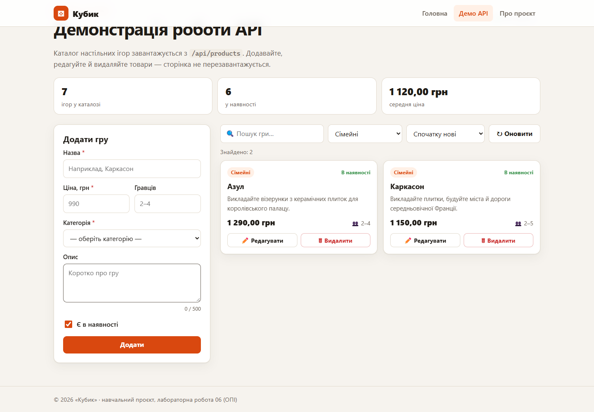
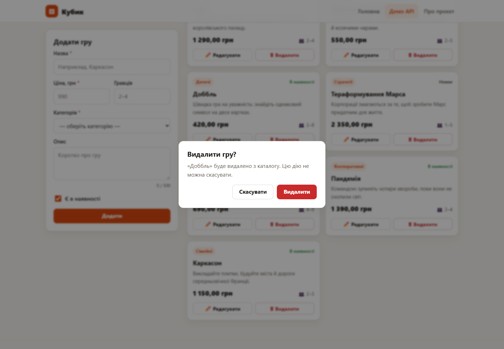
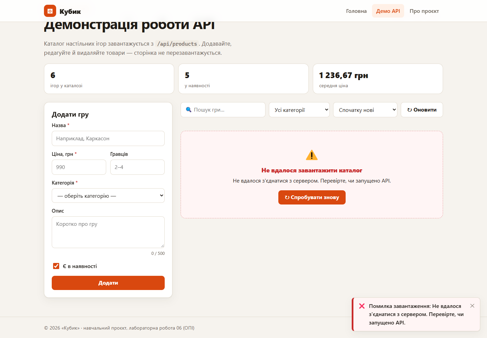
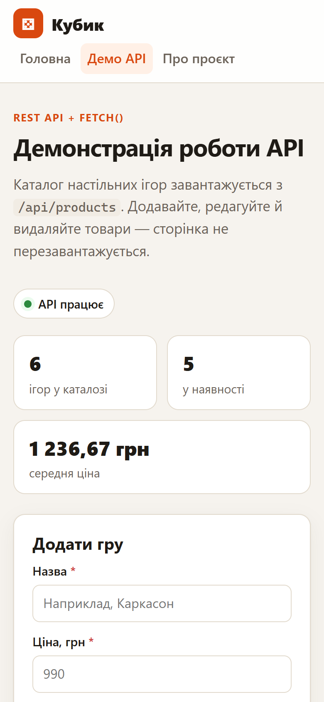
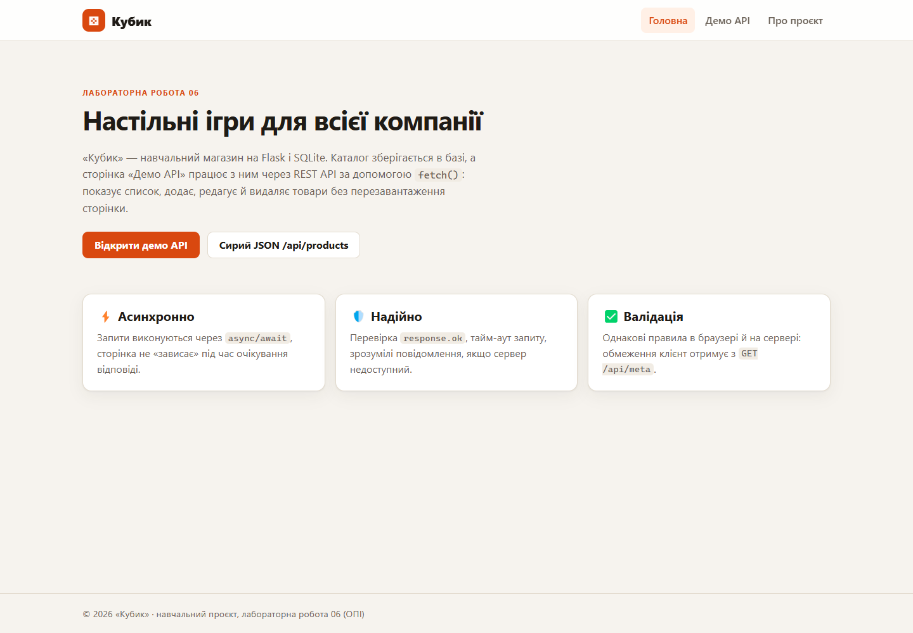

# Лабораторна робота 06. Інтеграція клієнтської частини з API та обробка помилок

**Проєкт:** «Кубик» — магазин настільних ігор (Flask + SQLite + REST API + клієнт на `fetch()`)
**Дисципліна:** Основи програмної інженерії

## 👥 Склад команди

Роботу виконано **одноосібно** — усі ролі виконав автор репозиторію:

| Роль | Що зроблено |
|------|-------------|
| Backend | REST API на Flask, валідація даних, єдиний формат помилок, CORS |
| Frontend | сторінка `/api-demo`, JavaScript-модулі для роботи з API, оформлення |
| Тестування | 43 автоматичні тести (API, сторінки, браузерні E2E-тести) |
| Документація | цей звіт, скриншоти, відповіді на контрольні запитання |

## 📝 Опис демонстраційної сторінки

Сторінка `/api-demo` показує каталог настільних ігор, який завантажується з REST API асинхронно через `fetch()` і `async/await`.
Через форму можна додати нову гру, відредагувати або видалити наявну, а також шукати, фільтрувати й сортувати список — без перезавантаження сторінки.
Будь-яка дія завершується зрозумілим повідомленням про успіх або помилку: від помилки у полі форми до повністю зупиненого сервера.

### Що реалізовано

- **Список ресурсів з API** (`GET`): картки з категорією, ціною, кількістю гравців і наявністю; статистика каталогу.
- **Додавання** (`POST`) і **редагування** (`PUT`) через одну форму; **видалення** (`DELETE`) з вікном підтвердження.
- **Пошук** (із затримкою 300 мс, щоб не відправляти запит на кожну літеру), **фільтр за категорією**, **сортування** — обробляються на сервері через параметри запиту.
- **Валідація форми у браузері**: повідомлення біля кожного поля, червона рамка, фокус на першому помилковому полі, лічильник символів опису.
  Обмеження приходять із `GET /api/meta`, тому вони **збігаються з серверною валідацією**.
- **Повторна перевірка на сервері**: якщо дані некоректні, API повертає `400` з помилками по полях (`fields`), і сторінка підсвічує ці поля.
- **Обробка помилок**:
  - перевірка `response.ok` (бо `fetch()` не вважає 404/500 помилкою);
  - текст помилки береться з відповіді сервера `{"error": "..."}`;
  - сервер недоступний (`Failed to fetch`) → «Не вдалося з'єднатися з сервером. Перевірте, чи запущено API.» і кнопка «Спробувати знову»;
  - тайм-аут 8 с через `AbortController`;
  - захист від «гонки» запитів: показується лише відповідь на останній запит;
  - індикатор стану API (зелений / червоний).
- **Безпека**: дані користувача виводяться лише через `textContent` (захист від XSS), SQL-запити параметризовані, сортування — через білий список.
- **Оформлення**: адаптивна верстка (комп'ютер, планшет, телефон), світла й темна теми, анімації, доступність (підписи полів, `aria-live`, `aria-invalid`, видимий фокус, перехід «до вмісту»).

## 🔌 Ендпоінти API, які використовує сторінка

| Метод | Адреса | Призначення | Коди відповіді |
|-------|--------|-------------|----------------|
| GET | `/api/health` | перевірка, що сервер працює | 200 |
| GET | `/api/meta` | категорії, варіанти сортування, обмеження полів | 200 |
| GET | `/api/products?search=&category=&sort=` | список товарів | 200, 400 |
| GET | `/api/products/<id>` | один товар | 200, 404 |
| POST | `/api/products` | створити товар | 201 (+ `Location`), 400 |
| PUT | `/api/products/<id>` | оновити товар | 200, 400, 404 |
| DELETE | `/api/products/<id>` | видалити товар | 204, 404 |

**Поля товару:**

| Поле | Тип | Правила |
|------|-----|---------|
| `id` | число | створюється базою |
| `name` | рядок | обов'язкове, 2–80 символів |
| `price` | число | обов'язкове, від 0 до 100 000 |
| `category` | рядок | одна з: Стратегії, Сімейні, Вечірки, Кооперативні, Карткові, Дитячі |
| `players` | рядок | до 20 символів, наприклад `2–4` |
| `description` | рядок | до 500 символів |
| `in_stock` | `true` / `false` | за замовчуванням `true` |
| `created_at`, `updated_at` | рядок | `YYYY-MM-DD HH:MM:SS`, заповнює сервер |

Приклад відповіді на некоректні дані (`POST /api/products` → `400 Bad Request`):

```json
{
  "error": "Вкажіть назву гри.",
  "fields": {
    "name": "Вкажіть назву гри.",
    "price": "Ціна має бути числом.",
    "category": "Оберіть категорію зі списку."
  }
}
```

## 📁 Де що розміщено

```
lab06-api-frontend/
├── app.py                  # фабрика застосунку, CORS, JSON-помилки для /api/*
├── models.py               # SQLite: схема і функції доступу до даних
├── validation.py           # серверна валідація товару (обмеження LIMITS)
├── seed_data.py            # тестові дані
├── routes/
│   ├── api.py              # REST API (7 ендпоінтів)
│   └── pages.py            # сторінки: /, /api-demo, /about
├── templates/
│   ├── base.html           # базовий шаблон з меню
│   ├── api-demo.html       # ⭐ HTML-шаблон клієнтської частини
│   ├── home.html, about.html, error.html
├── static/
│   ├── js/
│   │   ├── api-demo.js     # ⭐ головна логіка сторінки (завантаження, форма, видалення, фільтри)
│   │   ├── api-client.js   # ⭐ усі запити fetch(): response.ok, тайм-аут, тексти помилок
│   │   ├── validation.js   # валідація форми в браузері
│   │   └── ui.js           # повідомлення, картки, стан помилки, статистика
│   ├── css/style.css       # оформлення
│   └── img/favicon.svg
├── tests/                  # pytest: API, сторінки, E2E у браузері (Playwright)
├── scripts/make_screenshots.py
└── docs/screenshots/       # скриншоти для звіту
```

## 🚀 Запуск

```bash
python -m venv .venv
.venv\Scripts\activate            # Linux/macOS: source .venv/bin/activate
pip install -r requirements.txt
python seed_data.py               # тестові ігри (необов'язково)
python app.py
```

Відкрийте **http://127.0.0.1:5000/api-demo**.
Сторінку віддає той самий Flask-сервер, що й API, тому адреса API відносна (`/api/products`) і CORS для неї не потрібен.
CORS для `/api/*` все одно увімкнено (Flask-CORS), щоб клієнт працював і з іншого джерела, наприклад з Live Server на порту 5500.

### Тести

```bash
pip install -r requirements-dev.txt
python -m pytest            # 43 тести
```

| Файл | Що перевіряє |
|------|--------------|
| `tests/test_api.py` | коди відповідей, валідацію кожного поля, пошук, фільтр, сортування, 404/405 у JSON, CORS, захист від SQL-ін'єкції |
| `tests/test_pages.py` | сторінки відкриваються, на `/api-demo` є всі потрібні елементи, статичні файли віддаються |
| `tests/test_e2e.py` | у реальному браузері: завантаження списку, валідація форми, додавання, редагування, видалення, пошук, захист від XSS, повідомлення при зупиненому сервері |

```
43 passed in 14.10s
```

## 🖼️ Скриншоти

### Список даних з API


### Валідація форми (повідомлення про помилку)


### Додавання запису


### Повідомлення про успіх


### Редагування запису


### Фільтр за категорією


### Підтвердження видалення


### Сервер зупинено — зрозуміле повідомлення про помилку


### Мобільна версія


### Головна сторінка


## ✅ Висновки

У роботі клієнтську частину підключено до власного REST API: сторінка асинхронно отримує, створює, змінює й видаляє дані через `fetch()` і `async/await`, не блокуючи інтерфейс.
Головний висновок щодо обробки помилок: блоку `catch` недостатньо, бо `fetch()` відхиляє проміс лише за відсутності з'єднання, тому кожну відповідь треба перевіряти через `response.ok` і показувати текст помилки від сервера.
Валідація виконується двічі: у браузері для зручності користувача і на сервері для надійності, а спільні обмеження з `/api/meta` не дають цим правилам розійтися.
Виведення даних через `textContent` і параметризовані SQL-запити захищають застосунок від XSS та SQL-ін'єкцій.
Автоматичні тести, зокрема браузерні, підтверджують, що весь ланцюжок «HTML → JavaScript → API → база даних → сторінка» працює стабільно, зокрема коли сервер зупинено.

## ❓ Відповіді на контрольні запитання

1. **Що таке асинхронність у JavaScript? Навіщо вона потрібна?**
   Це можливість запустити довгу операцію (наприклад, запит до сервера) і продовжити роботу, не чекаючи її завершення; результат обробляється, коли він надійде. Без асинхронності сторінка «зависала» б на час кожного запиту.
2. **Чим відрізняється GET запит від POST запиту?**
   GET отримує дані, не змінюючи їх, а параметри передаються в адресі (`?search=...`). POST створює новий ресурс, а дані передаються в тілі запиту (у нас — JSON). Сервер відповідає на успішний POST кодом `201 Created`.
3. **Що таке JSON і навіщо він потрібен?**
   Текстовий формат обміну даними, схожий на об'єкти JavaScript. Його однаково розуміють браузер (`JSON.stringify` / `response.json()`) і сервер на Python (`jsonify` / `get_json`).
4. **Що робить функція `fetch()`?**
   Відправляє HTTP-запит і повертає проміс з об'єктом `Response` (статус, заголовки, тіло).
5. **Навіщо потрібен `await` перед `fetch()`?**
   `fetch()` повертає проміс, а не готову відповідь. `await` призупиняє лише поточну `async`-функцію до отримання відповіді, і далі код працює з результатом як зі звичайним значенням.
6. **Що таке CORS і чому виникають помилки CORS?**
   Механізм, яким сервер дозволяє сторінкам з іншого джерела (протокол + домен + порт) звертатися до нього. Помилка виникає, коли сторінка й API мають різні джерела (наприклад, `127.0.0.1:5500` і `127.0.0.1:5000`), а сервер не надіслав заголовок `Access-Control-Allow-Origin`. У проєкті це вирішено Flask-CORS для адрес `/api/*`.
7. **Як у коді обробляються помилки при роботі з API? Чому недостатньо лише блоку `catch`?**
   У `static/js/api-client.js` усі запити проходять через функцію `request()`. Вона перехоплює мережеві помилки й тайм-аут (`catch`), перевіряє `response.ok`, читає текст помилки з `{"error": ...}` і кидає `ApiError` зі статусом та помилками полів. На сторінці помилки показуються в повідомленнях, біля полів форми або як стан «Не вдалося завантажити каталог» з кнопкою повтору.
   Одного `catch` недостатньо, бо `fetch()` вважає відповіді 400, 404 і 500 успішними, і без перевірки `response.ok` такі помилки пройшли б непоміченими.
